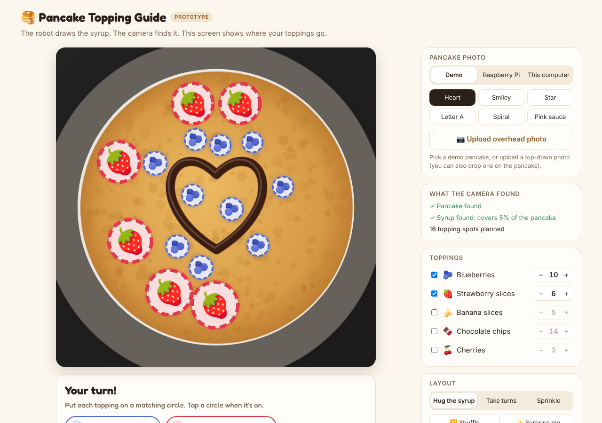
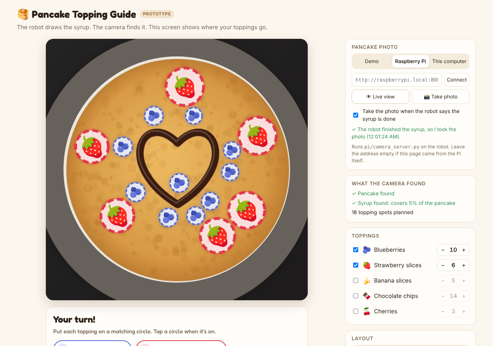

# Pancake Topping Guide

The display software for our pancake decorator robot. The robot draws a design in chocolate syrup (or any flat sauce). An overhead camera photographs the pancake. This screen then shows the user where to put the other toppings around the syrup.

The goal is the **IKEA effect**: the robot does the hard part, and the user gets a small finishing job they can't fail at, which makes the pancake feel like theirs.



## Running it

The app is three plain files, `index.html`, `styles.css` and `script.js`, with no build step and no install.

- Double-click `index.html` to open it in Chrome, Edge, Firefox or Safari.
- Or serve the folder: `python3 -m http.server 8000`, then open http://localhost:8000

It loads a Google Font (Fredoka) if you're online. Offline, it falls back to the system font and still works.

On the robot, run the camera server instead (see [Camera setup](#camera-setup)). It serves the same page at http://raspberrypi.local:8000.

## Using it

| Panel | What it does |
|---|---|
| **Pancake photo** | Three tabs. **Demo**: six demo pancakes (heart, smiley, star, letter, spiral, pink sauce), or upload a top-down photo or drag one onto the pancake. **Raspberry Pi**: live view and photos from the robot's overhead camera, with an automatic photo when the robot finishes the syrup. **This computer**: this device's own webcam, for testing without a Pi. |
| **What the camera found** | Whether it found the pancake and syrup, how much of the pancake is syrup, and a warning if a topping doesn't fit. |
| **Toppings** | Turn toppings on or off and set how many of each. |
| **Layout** | *Hug the syrup* puts each topping in its own ring around the syrup. *Take turns* alternates toppings on one ring. *Sprinkle* scatters them, filling spots closest to the syrup first. *Shuffle* gives a new random arrangement, and *Surprise me* picks a random layout with 1–2 toppings. |
| **Screen** | *Photo + guides* is for a screen next to the robot. *Projector* shows only the circles on black, for shining onto the pancake. *Show what the camera detected* highlights the syrup in pink and the pancake edge in green. |
| **Tuning** | Pancake diameter (sets real-world size), gap from syrup, and the syrup detection threshold. |
| **Export** | JSON of every spot in millimetres from the pancake center, for the robot team. |

Kids tap a circle once that topping is on it. When every circle is checked off, the celebration screen appears (or they can press **I'm done!**).

## Camera setup



The Pi owns the camera, and the display asks it for photos:

1. `pi/camera_server.py` runs on the Pi and controls the camera. It works with a USB webcam or the Pi Camera Module.
2. The display connects to it, shows a live view so you can line up the pancake, and asks for a photo.
3. When the robot finishes the syrup, its code makes one call, `POST /api/syrup-done`. Displays notice within a second and take the photo on their own, so nobody has to press anything.

Why a server instead of the browser opening the camera directly:

- The robot needs the camera too (for the photo-and-correct ILC loop). Only one program can open a camera at a time, so one server shares it with everything.
- The screen can be anywhere: the Pi's own screen, a tablet or a laptop on the same Wi-Fi all just open `http://raspberrypi.local:8000`.
- The Pi knows when the syrup is done, so the photo can happen automatically.

### On the Pi

```bash
git clone https://github.com/freastrid-a11y/pancakedecoratorbot.git
cd pancakedecoratorbot
python3 pi/camera_server.py
```

| Camera | What to install | How to start |
|---|---|---|
| Pi Camera Module | nothing: `picamera2` comes with Raspberry Pi OS | `python3 pi/camera_server.py --camera pi` |
| USB webcam | `sudo apt install python3-opencv` | `python3 pi/camera_server.py --camera usb` (add `--device 1` for a second webcam) |
| No camera (testing) | nothing | `python3 pi/camera_server.py --camera file` (serves `pi/sample_pancake.jpg`) |

With no `--camera`, it uses the Pi Camera Module if there is one, otherwise USB webcam 0. Other options: `--port`, `--width`/`--height` (default 1280×960), `--fps` for the live view (default 10). `python3 pi/camera_server.py --help` lists them all.

To start it when the Pi boots, use `pi/pancake-camera.service` (instructions are at the top of the file).

Then open `http://raspberrypi.local:8000` (or the Pi's IP address) on any screen on the same network. A page opened from the Pi starts on the **Raspberry Pi** tab and connects by itself. If you open `index.html` from somewhere else, type the Pi's address in that tab and press **Connect**; it's remembered next time. You can also link straight to it: `index.html?source=pi&pi=192.168.1.42:8000`.

### From the robot's code

```python
import sys; sys.path.insert(0, "pi")
from robot_client import syrup_done, snapshot

# ... robot finishes drawing the syrup ...
syrup_done()          # every display with auto-capture on takes the photo
jpeg = snapshot()     # the robot can grab its own photo too (bytes, JPEG)
```

Or from the shell: `curl -X POST http://localhost:8000/api/syrup-done`.

| Endpoint | What it does |
|---|---|
| `GET /api/status` | `{"camera": "Pi Camera Module", "camera_ok": true, "error": null, "syrup_done": 3, ...}` |
| `GET /api/snapshot.jpg` | One fresh JPEG from the camera |
| `GET /api/stream` | Live MJPEG stream (an `` can show it) |
| `POST /api/syrup-done` | Signals that the syrup is finished; `syrup_done` counts up |

The server only uses the Python standard library itself, and sends CORS headers so a page opened from anywhere can use it. It only serves `index.html`, `styles.css` and `script.js`, not the rest of the folder.

### Testing without a Pi

The **This computer** tab uses the laptop's webcam through `getUserMedia`. Browsers only allow that on `https://` pages, `http://localhost`, or a file opened by double-clicking. Hold the camera straight above the pancake.

## How it works

The display's code lives in `script.js`, in sections:

1. **Find the pancake** (`analyze`): The photo is shrunk to about 260 px wide for speed. Golden-brown pixels are kept (hue 12–55°, saturation ≥ 0.22, brightness ≥ 0.40), then a circle is fitted to them. The center is their average position and the radius is the 97th-percentile distance, refined 3 times.
2. **Find the syrup**: The program takes the median pancake color. Any pixel inside the circle whose color differs from it by more than the **threshold** counts as syrup. Because it compares colors instead of looking for "dark brown", it works for any sauce color. Small specks are then removed: one erode and dilate pass, then any blobs smaller than 0.2% of the pancake are dropped.
3. **Distance map** (`chamfer`): For every pixel, the program measures how far it is to the nearest syrup.
4. **Plan spots** (`plan`):
   - Pixel size is converted to millimetres with the pancake diameter, so each topping gets its real size (blueberry 12 mm, strawberry slice 24 mm, and so on).
   - Every spot must keep the **gap** from the syrup, 3 mm from the pancake edge, and 2 mm from other toppings.
   - Ring layouts collect the pixels at exactly the right distance from the syrup, chain them into a path, and space toppings evenly along it.
   - Anything that doesn't fit on a ring falls back to sprinkle.
5. **Draw** (`draw`): The program renders the photo (or black, in projector mode), the detection overlay and the pulsing guide circles at about 60 fps.
6. **Camera** (`CAM`): Talks to the camera server or the webcam. Live view is an `` (MJPEG stream) or `<video>` laid over the pancake. Every photo, whether uploaded, from the Pi or from the webcam, goes through `useFrame`, which shrinks it to 1200 px and runs steps 1–4.

Layouts use a seeded random number generator (`mulberry32`), so the same seed always gives the same layout.

### Adding a topping

Add a line to the `TOPPINGS` list near the top of `script.js`:

```js
{id:'raspberry', name:'Raspberries', emoji:'🍇', color:'#c2185b', mm:15, count:6, max:12},
```

`mm` is the real diameter. It decides both the circle size and how close toppings can be to each other.

## Tests

For testing by hand, from a laptop to real pancakes on the robot, see [TESTING.md](TESTING.md).


```bash
python3 -m venv .venv && source .venv/bin/activate
pip install -r requirements-dev.txt
python -m playwright install chromium

python tests/test_camera_server.py   # the Pi server, standard library only; with OpenCV installed, also the USB-webcam path
python tests/test_layouts.py         # every demo × every layout; prints what was detected and planned
python tests/test_tapping.py         # taps every spot, checks the celebration shows, screenshots projector mode
python tests/test_camera_ui.py       # starts the server and checks live view, Take photo, auto photo, webcam mode and a wrong address
python tests/test_ilc.py             # the learning loop (ILC) on the simulated robot, and through the camera server
```

The browser tests use [Playwright](https://playwright.dev/python/). Set `CHROMIUM_PATH` to use a Chrome you already have instead of Playwright's. `test_camera_ui.py` uses Chrome's built-in fake webcam, so no camera is needed. Screenshots are saved to `test-output/` (ignored by git). The browser tests print `ERRORS: []` / `[]` when there are no JavaScript errors. A font-loading error is normal if you're offline.

## Known limitations / next steps

- **Only tested on drawn demo pancakes so far.** Real photos will need the threshold tuned. Dark cooking spots can be mistaken for syrup, and shiny glare on syrup can be missed. Use the detection view while tuning.
- **The camera code hasn't run on a real Pi yet.** It was tested with a sample photo, a video file through OpenCV, and Chrome's fake webcam. Expect to adjust the camera position and the detection threshold the first time.
- The camera is assumed to be roughly straight overhead. A tilted camera would need perspective correction.
- The robot can learn to draw better syrup lines from the camera photos (iterative learning control). It's tested on a simulated robot so far: see [pi/ilc/README.md](pi/ilc/README.md).
- Ideas: check topping placements with the camera, sound effects, and a bigger touch-only "kid mode" for a small screen.
