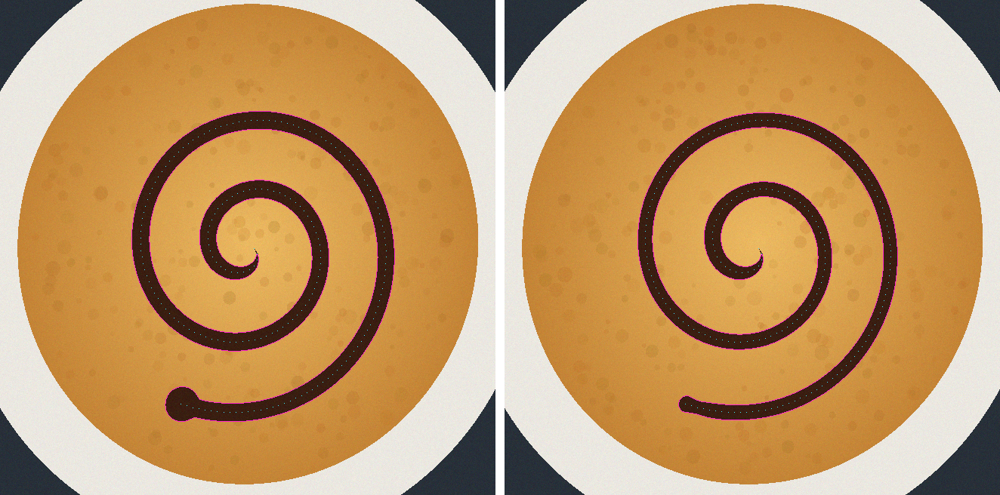

# ILC: the robot learns to draw better syrup lines

Each pancake is one try. After the robot draws the syrup, the overhead camera photographs it, the code measures how wide the line came out at every point, and the robot adjusts its pump (or speed) at those points for the next pancake. Corrections are saved per design, so every letter and shape keeps improving.



*Simulated spiral, pancake 1 (left) and pancake 10 (right).*

```
draw with the learned commands  ->  photograph  ->  measure width at every point  ->  adjust  -> (next pancake)
```

This works because most of what goes wrong repeats every time the same shape is drawn. The pump reacts late, so the start of a stroke is thin and the end gets a blob. The robot slows down on tight curves, so the line comes out wider there. Iterative learning control (ILC) learns exactly those repeating errors. It can't fix random differences between pancakes, and it shouldn't try.

Only `numpy` is needed. Reading camera JPEGs on the robot also needs OpenCV or Pillow, and Raspberry Pi OS has both available.

## Try it: the simulator

```bash
python3 pi/ilc/simulate.py
```

This runs every built-in design (heart, star, spiral, smiley, A) for 10 simulated pancakes. It prints the width error for each pancake, then a before → after summary:

```
Before -> after (learning flow): true width error, pancake 1 -> pancake 10
  heart     0.85 mm ->  0.16 mm  ( -81%)   within ±1 mm:  91% -> 100%   end blobs:   85 ->   79 mm³
  spiral    1.04 mm ->  0.11 mm  ( -90%)   within ±1 mm:  94% -> 100%   end blobs:   85 ->   22 mm³
  ...
```

Open **`test-output/ilc/report-flow.html`** in a browser to see the before and after. For each design it shows:
- the first and last pancake photos, with the detected syrup outlined in pink and the planned path in cyan;
- the width error for every pancake;
- the line width along the whole path, before and after, against the target.

Each run writes its own report (`report-speed.html`, `report-flow-noilc.html`), so you can compare them side by side.

```bash
python3 pi/ilc/simulate.py --design heart -n 15
```

```bash
python3 pi/ilc/simulate.py --control speed
```

```bash
python3 pi/ilc/simulate.py --no-ilc
```

The last one is the baseline: the same commands on every pancake.

The simulated robot has a pump with a 0.15 s delay and 0.3 s lag, an acceleration limit that slows it on curves, syrup that's thinner than the controller assumes, and 4% random variation per pancake.

Results with the default settings, after 10 pancakes. The numbers are the true RMS width error, which the simulator knows exactly, over the points that can be measured. The target width is 5 mm.

| Design | No learning | Learning pump flow | Learning speed |
|---|---|---|---|
| Heart | 0.84 mm | **0.16 mm** | **0.12 mm** |
| Star | 0.82 mm | **0.15 mm** | **0.14 mm** |
| Spiral | 1.03 mm | **0.11 mm** | 0.33 mm |
| Smiley | 1.36 mm | 0.82 mm | 0.63 mm |
| Letter A | 1.88 mm | 1.19 mm | 0.97 mm |

Most of the improvement comes in the first 3 pancakes. Learning pump flow also cuts the blob at the end of each stroke, for example from 85 to 22 mm³ on the spiral. Learning speed can't do that, because the blob is syrup that drips after the robot has stopped.

What's left on the smiley and the A is mostly at **stroke starts**. The robot starts moving before the pump has built up flow, so the first few millimetres are thin even at 100% pump. No per-point command can fix that. Starting the pump slightly before moving would, and it's listed under next steps.

## How it works

| File | What it does |
|---|---|
| `designs.py` | Designs as strokes in mm (the same shapes as the display's demos), split into points every 2 mm. Designs can also be loaded from JSON. |
| `vision.py` | Syrup detection (a port of the display's), camera calibration, and measuring the line width and sideways offset at every point. |
| `learn.py` | The ILC update, the per-design corrections store, and `Learner`, which ties them together. |
| `simulator.py` | The simulated robot and camera. |
| `simulate.py` | Runs the loop on the simulator. |
| `report.py` | Writes the before/after report page for a simulator run. |
| `robot_loop.py` | Runs the loop on the real robot through the camera server, plus the `calibrate` and `status` commands. |

**Calibration.** Camera pixels have to be matched to robot millimetres. The robot draws five syrup dots at known positions (`CALIBRATION_DOTS` in `vision.py`: a 80 mm square plus an extra dot so it's not symmetric). The code finds them in a photo and fits a homography, which also handles a slightly tilted camera. On the simulator it's accurate to 0.02 mm.

**Measuring.** At every point, the code samples the syrup mask along a line across the path and finds the run of syrup there. That gives the width, and how far off-centre the line is. Some points can't be measured honestly and are skipped (no correction there):
- where another stroke is close, like the crossbar of the A;
- where a closed shape meets itself, like the start and end of the heart;
- at sharp corners, where the cross-section cuts through both arms.

**The update** (`ilc_update` in `learn.py`), for each point *i* of each stroke:

```
error(i)     = (measured width - target) / target
command(i)  -= gain × nominal × error(i + lead)        # flow: too wide -> less flow
                                                        # speed: the sign flips, too wide -> faster
command      = moving average(command), clipped to the pump/motor limits
```

| Setting | Default | What it does |
|---|---|---|
| `gain` | 0.5 | How much of the error is corrected each pancake. Higher learns faster but reacts more to random pancake-to-pancake differences. 0.3–0.7 is sensible. |
| `lead_mm` | 8 for flow, 0 for speed | How far ahead along the path the error is used. The pump reacts late, so the syrup at point *i* + lead was caused by the command at point *i*. Roughly speed × (pump delay + lag). Speed acts at once, so it needs no lead. |
| `smooth_mm` | 6 | The moving-average width. It stops camera noise from making the pump jitter. |
| `spacing` | 2 mm | Distance between control points. |
| `threshold` | 55 | Syrup detection threshold, the same as the display's slider. |

The lead matters. Learning speed with the pump's 8 mm lead left the heart at 0.50 mm after 10 pancakes, against 0.12 mm with no lead.

**Corrections** are saved in `pi/ilc/corrections/<design>.json`: the command at every point, the error history and the settings used. If the design or the point spacing changes, that design starts again from the nominal command instead of using corrections that no longer match. Learning flow and learning speed are kept apart the same way. `Learner.reset("heart")` forgets one design.

## On the real robot

**1. Calibrate** once, and again if the camera or the robot moves. Have the robot draw the calibration dots on a pancake, make sure the camera server is running, then:

```bash
python3 pi/ilc/robot_loop.py calibrate
```

This saves `pi/ilc/calibration.json`. If it can't find 5 dots, check the photo at `http://raspberrypi.local:8000/api/snapshot.jpg`.

**2. In the robot's code**, wrap each pancake in `RobotLoop.pancake`:

```python
import sys; sys.path.insert(0, "pi")
from ilc import ILCSettings
from ilc.robot_loop import RobotLoop

loop = RobotLoop(ILCSettings(control="flow", nominal=0.75))   # nominal: the pump setting you use today

def draw(points, commands):
    # points[s]:   (N, 2) array, mm, the path of stroke s, a point every 2 mm
    # commands[s]: (N,) array, the pump setting (0..1) at each point (or speed in mm/s)
    for pts, cmd in zip(points, commands):
        ...  # move along pts, setting the pump to cmd[i] as you pass pts[i]

report = loop.pancake("heart", draw)   # draws, tells the displays, takes the photo, learns
print(report["stats"])                 # {'rms_mm': 0.4, 'within_1mm': 0.97, ...}
```

`pancake()` calls `syrup_done()` itself, so the displays take their photo at the same time. Every photo is kept in `pi/ilc/corrections/photos/`.

**3. Watch it learn:**

```bash
python3 pi/ilc/robot_loop.py status
```

```
heart        flow     6 pancakes   width error (mm): 0.72 -> 0.33 -> 0.92 -> 0.26 -> 0.28 -> 0.62
```

Single pancakes jump around: a warmer bottle of syrup or a differently browned pancake changes the width by 10–20%. Judge the trend over several pancakes, not one.

**Before using it on the robot, check:**
- The robot's coordinates must match the designs: mm, centred on the design, with +y pointing towards the bottom of the camera image. The calibration takes care of the camera's rotation and offset, but not of a mirrored axis. If `calibrate` fails with "could not match the dots", the y axis is probably flipped.
- `nominal` should be the pump setting (or speed) that gives roughly the right width today. ILC fixes the details, not a setting that's far off.
- Make the commands limits (`lo`, `hi`) match what the pump or motors can actually do.

## Next steps

- **Start the pump early.** Turning the pump on slightly before the robot moves would fix thin stroke starts. That timing could be learned too, from the error at the first few points.
- **Learn flow and speed together.** Flow handles end blobs and steady width, speed handles sharp shapes like the star.
- **Learn position** from the measured sideways `offset`, by shifting the path a little where the line lands off-centre.
- **Show it on the display**, for example "the robot is learning" with the error per pancake.
- **Tune the simulator to the real robot.** Measure the pump's delay and lag by running it with the robot standing still and filming the flow start and stop. Then set `RobotModel` to match and choose `lead_mm` and `gain` on the simulator before using them for real.
